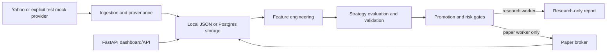

# Project Invest

[](https://github.com/expediential/project-invest/actions/workflows/ci.yml) [](LICENSE)

Project Invest is an experimental, paper-only quantitative research workspace. It collects permitted market data, engineers simple features, evaluates bounded strategy candidates, applies independent risk controls, and records simulated portfolio activity. Its purpose is to make research decisions inspectable—not to predict markets or promise returns.

> **Status:** early research software. Paper fills, costs, and performance are simulated. No broker adapter or live trading is supported.

## What works today

- FastAPI workstation dashboard and read-only health/runtime, market, portfolio, trade, event, analytics, portfolio-summary/history, data-quality, and compute-status endpoints.
- Read-only portfolio-summary/history/position APIs with fee-aware accounting, stored-snapshot performance history, data-quality status, and an honest local/Cosmos compute-status view.
- Explicit research-only and paper-trading worker modes, local JSON storage, optional Postgres/Redis storage paths, and Yahoo or explicitly opted-in mock data.
- Basic technical features, three bounded rule-based strategy families, cost-aware backtests, promotion gates, risk limits, and paper portfolio accounting.
- Point-in-time local sentiment observations and a walk-forward candidate validation path that excludes a final holdout.
- A bounded `LOCAL-LITE` research queue: one durable, research-only job at a time, with heartbeats, timeout, explicit cancellation requests, and safe interrupted-job recovery.
- Cached local runtime telemetry for CPU/RAM/disk/network/API-process use, with optional NVIDIA telemetry when `nvidia-smi` is genuinely available.

Reproducible experiment artifacts, model training, rigorous portfolio optimization, external event ingestion, and Cosmos/HPC access are planned—not implemented.

## Architecture



## Quick start

Windows PowerShell:

```powershell
python -m venv .venv
.venv\Scripts\python -m pip install -e .[dev]
Copy-Item .env.example .env
# Set PROJECT_INVEST_API_AUTH_TOKEN in .env before using operational routes.
.venv\Scripts\python -m project_invest api --host 127.0.0.1 --port 8000
```

Linux/macOS:

```sh
python3 -m venv .venv
.venv/bin/python -m pip install -e '.[dev]'
cp .env.example .env
.venv/bin/python -m project_invest api --host 127.0.0.1 --port 8000
```

Open `http://127.0.0.1:8000`. Read-only routes are available without a token. The normal local `launch` command creates a temporary token and signs the localhost dashboard in automatically for that run. Direct API calls require `Authorization: Bearer <PROJECT_INVEST_API_AUTH_TOKEN>`; API-only and non-local runs without a token return a safe `503` response.

The workstation is read-only on refresh: chart and feature panels use already stored data and never trigger a provider request. Its runtime strip distinguishes API, storage, stored-market-data freshness, research-worker heartbeat, trading-worker heartbeat, and unavailable remote compute. Research requests are queued to LOCAL-LITE; the authenticated paper-trading control remains explicit.

The Runtime / Compute view samples on a bounded background interval (five seconds by default) and serves the latest cached sample. It never gathers telemetry in a dashboard request. If `psutil` or NVIDIA tooling is absent, the relevant metric is shown as unavailable rather than zero. The **Queue Research Cycle** control is authenticated and creates a local research-only job; it does not trade, submit orders, or auto-restart interrupted work.

## Running the system

```powershell
# Research only; cannot submit paper orders.
.venv\Scripts\python -m project_invest worker --mode research

# Paper-trading worker. It still rejects live execution and mock/unknown data.
.venv\Scripts\python -m project_invest worker --mode trading

# Convenience launcher: API plus the two separate workers.
.venv\Scripts\python -m project_invest launch --host 127.0.0.1 --port 8000
```

Do not run more than one worker of a given role against the same storage until the planned durable lease mechanism exists.

### LOCAL-LITE monitoring and jobs

`LOCAL-LITE` deliberately allows one research job at a time. Its CPU and memory configuration values are monitoring thresholds, not operating-system process-kill limits. Inspect cached status at `GET /api/runtime/monitor`, durable jobs at `GET /api/jobs`, and the combined component view at `GET /api/runtime/status`.

On Windows, update dependencies after pulling this change and start as usual:

```powershell
.venv\Scripts\python -m pip install -e .[dev]
.\run-project-invest.cmd
```

Jobs left `running` by a stopped executor are marked `failed` at next startup with a manual-resubmission message. A Cosmos backend interface exists only as an explicit `not_configured` placeholder. Before implementing it, confirm cluster authentication, scheduler, allocation, container/runtime, storage, network, logging, data-governance, cancellation, and quota requirements with the administrator.

## Configuration and data safety

| Variable | Safe default | Meaning |
| --- | --- | --- |
| `PROJECT_INVEST_EXECUTION_MODE` | `paper` | The only supported execution mode; `live` fails startup. |
| `PROJECT_INVEST_BASE_CURRENCY` | `INR` | Three-letter display currency for paper-portfolio reporting. It does not convert market values. |
| `PROJECT_INVEST_MARKET_DATA_PROVIDER` | `yahoo` | Market provider. |
| `PROJECT_INVEST_ALLOW_MOCK_DATA` | `false` | Mock data requires this plus `development` or `test` environment. |
| `PROJECT_INVEST_API_AUTH_TOKEN` | unset | Required for cycle-triggering API routes. Never commit it. |
| `PROJECT_INVEST_STORAGE_BACKEND` | `local` | `local` or configured `postgres`. |
| `PROJECT_INVEST_RESEARCH_LOOP_ENABLED` | `false` | Embedded API loops are unsupported and fail startup. |
| `PROJECT_INVEST_RUNTIME_MONITOR_INTERVAL_SECONDS` | `5` | Background telemetry sampling interval; dashboard requests read the cached sample. |
| `PROJECT_INVEST_LOCAL_LITE_CONCURRENCY` | `1` | Fixed single-concurrency research queue profile. |

Yahoo availability, timestamps, corporate actions, exchange calendars, and intraday coverage are limitations. Provider failures do not silently turn into synthetic data. Mock candles are clearly marked and are rejected at the paper-trading boundary unless deliberately enabled for tests/development.

## Research and paper-trading limitations

Backtests include configured fees and slippage but remain simplified simulations. A strategy is selected from development data; walk-forward validation reserves a final holdout from candidate validation. Local historical sentiment requires both publication and observation timestamps—legacy static sentiment is not used to reconstruct historical features. Results remain vulnerable to data quality, survivorship bias, market-regime changes, execution assumptions, and multiple-testing bias.

Paper orders model fills, fees, cash, positions, realized P&L, and marked-to-market equity. They are not real orders or realized financial returns. Risk controls are independent of strategy scores, but this prototype is not production-ready.

## Tests and CI

```powershell
.venv\Scripts\python -m compileall -q src
.venv\Scripts\python -m pytest -q --basetemp .tmp_pytest -p no:cacheprovider
```

CI runs these checks on pushes to `main` and external pull requests. Tests use deterministic fixtures and do not require market-provider access, broker credentials, or private data.

## Docker and deployment

Docker Compose files exist for local experimentation and a VM topology, but they require a deliberately configured `.env`. Before any accessible deployment, use HTTPS, restrict network access, configure an operational token, keep paper mode, and set mock fallback/data to false. The current deployment guides require revision before public deployment; do not treat them as a production hardening guide.

## Documentation

- [Architecture](ARCHITECTURE.md)
- [Implementation audit](docs/IMPLEMENTATION_AUDIT.md)
- [Research risk register](docs/RESEARCH_RISK_REGISTER.md)
- [Roadmap](docs/ROADMAP.md)
- [UI and reliability audit](docs/UI_AND_RELIABILITY_AUDIT.md)
- [Contributing](CONTRIBUTING.md)
- [Security policy](SECURITY.md)
- [Changelog](CHANGELOG.md)
- [MIT License](LICENSE)

Cosmos/HPC is a future optional research accelerator. It must remain separate from order execution and is not integrated or assumed available.

## Contributing and license

Please read [CONTRIBUTING.md](CONTRIBUTING.md) and [CODE_OF_CONDUCT.md](CODE_OF_CONDUCT.md) before opening an external contribution. Project Invest is licensed under the [MIT License](LICENSE).
